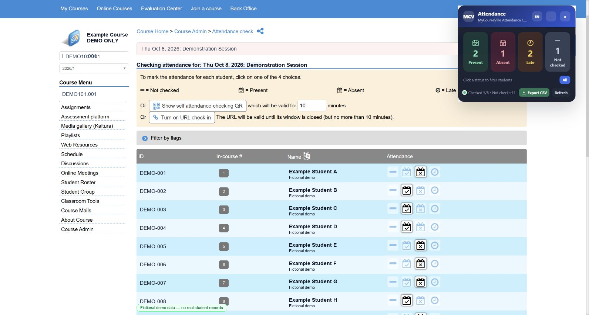
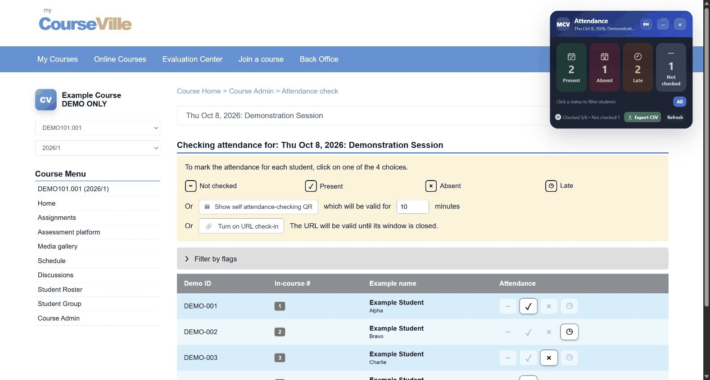

# MyCourseVille Attendance Overlay

A lightweight Chrome and Microsoft Edge extension that displays an attendance summary directly on MyCourseVille attendance-check pages.

This source code is intentionally published as an open-source project for educational use. MyCourseVille is the learning management system (LMS) used by Chulalongkorn University, and this extension is designed to make attendance information on that system easier to review.

> **Disclaimer:** This is an independent, unofficial project. It is not affiliated with, endorsed by, or sponsored by MyCourseVille, the Learning Innovation Center, or Chulalongkorn University.

> **Privacy first:** This extension does not send any data to the developer or to any external server. It does not read, collect, store, transmit, or modify MyCourseVille usernames, passwords, cookies, session tokens, or other credentials.

Developed by [Hideokun13](https://github.com/Hideokun13).

## Features

- Counts students in four attendance states: Present, Absent, Late, and Not checked.
- Filters the student table by attendance state without changing data on MyCourseVille.
- Provides a draggable, collapsible overlay with a manual refresh button.
- Automatically refreshes the summary when attendance selections change.
- Exports all student attendance data as a MyCourseVille-compatible CSV file.
- Supports English and Thai with a persistent language switch.
- Works only on MyCourseVille attendance-check pages.

## Preview



The screenshot above uses fictional `DEMO-*` identifiers and example names created solely for documentation. It contains no real student information or MyCourseVille account data.

### Filter Animation



The animation demonstrates the actual status-filter behavior in English using fictional students only.

## Install and Use in Google Chrome

1. Download the `.crx` file from the release.
2. Open Google Chrome and enter `chrome://extensions` in the address bar.
3. Enable **Developer mode** using the switch in the upper-right corner.
4. Drag the downloaded `.crx` file onto the Extensions page and approve the installation prompt.
5. If Chrome blocks installation of a self-hosted CRX because it is not distributed through the Chrome Web Store, clone this repository instead, select **Load unpacked**, and choose the project folder containing `manifest.json`.
6. Optionally select the Extensions button in the Chrome toolbar and pin **MyCourseVille Attendance Overlay** for easier access.
7. Sign in to MyCourseVille and open a course.
8. Go to **Course Admin > Attendance Check**, then open the attendance session you want to review.
9. Refresh the page if it was already open before the extension was installed. The attendance overlay will appear automatically in the upper-right corner.

For an unpacked installation, replace the project files when updating, return to `chrome://extensions`, select **Reload** on the extension card, and refresh the MyCourseVille page.

## Install and Use in Microsoft Edge

1. Download the `.crx` file from the release.
2. Open `edge://extensions` in Microsoft Edge.
3. Enable **Developer mode**.
4. Drag the `.crx` file onto the Extensions page and approve the installation prompt.
5. If Edge blocks the CRX, clone this repository, select **Load unpacked**, and choose the project folder containing `manifest.json`.
6. Open or refresh a MyCourseVille attendance-check page.

## Usage

- Select a status card to show only students with that status.
- Select **All** to restore the complete student list.
- Select **Refresh** to rescan the current page manually.
- Select **Export CSV** to download attendance data for every student, regardless of the active filter.
- Select **EN** or **TH** in the overlay header or extension popup to switch languages.
- Drag the overlay by its header or minimize it with the minus button.

## Attendance Status Mapping

| MyCourseVille status | Overlay label | CSV value |
| --- | --- | --- |
| Present | Present / เช็คชื่อ | `1` |
| Absent | Absent / ขาด | `0` |
| Late | Late / สาย | `0.5` |
| Not checked | Not checked / ไม่ได้เช็ค | `-` |

## CSV Export

The exported CSV follows the structure of a MyCourseVille attendance export. It uses UTF-8 with a byte order mark and CRLF line endings for compatibility with spreadsheet applications.

The filename format is:

```text
[course-code]-[DD-MMM-YY]-[attendance-name].csv
```

Characters that are invalid in Windows, macOS, or Linux filenames are replaced or removed automatically. Course title fields are left blank when they are not available on the attendance page.

## Privacy

The extension operates entirely inside the user's browser:

- It does not send attendance data or any other information to the developer or to an external server.
- It contains no analytics, telemetry, tracking, advertising, or remote API integration.
- It does not read, collect, store, transmit, or modify MyCourseVille usernames, passwords, cookies, session tokens, or other authentication credentials.
- MyCourseVille authentication remains entirely between the user's browser and MyCourseVille. The extension does not participate in the login process.
- It reads only the attendance information already displayed on the current attendance-check page to calculate counts and apply visual filters.
- CSV files are generated locally and downloaded only when the user selects **Export CSV**.
- The extension stores only local interface preferences: enabled/disabled state, collapsed state, overlay position, and selected language.

The developer cannot view or retrieve a user's attendance data, browsing activity, or MyCourseVille account information through this extension.

## Permissions

- `storage` saves the overlay's local interface preferences, including the selected language.
- `activeTab` lets the extension popup inspect and refresh the active attendance page after the user opens the popup.
- Access to `https://www.mycourseville.com/*` allows the content script to run on MyCourseVille. The overlay activates only when the current URL is an attendance-check page.

## Development

Run the detector and export tests with Node.js:

```powershell
node test-detector.js
```

You can also open `test-fixture.html` in a browser for a local visual test.

## License

This project is licensed under the [MIT License](LICENSE).

Copyright © 2026 Hideokun13.

## Trademark Notice

MyCourseVille and other third-party names, logos, and marks are the property of their respective owners. They are referenced only to describe compatibility with the service.
